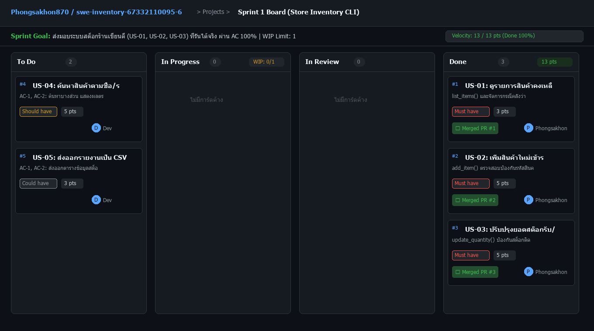

# Sprint Retrospective: Sprint 1

## Velocity
- Story point ที่วางแผน: 13
- Story point ที่ทำสำเร็จ (Done): 13
- Velocity Sprint 1: 13 points

### การวิเคราะห์ Velocity และรอบการทำงาน
1. **Issue ไหนใช้เวลานานที่สุดจาก In Progress ถึง Done:**
   - Issue #3 (US-03: ปรับปรุงยอดสต็อกรับ/จ่าย): ใช้เวลามากที่สุดเนื่องจากต้องตรวจสอบกรณี Edge Case ป้องกันสต็อกติดลบ (Negative Quantity Prevention) และการจัดการข้อผิดพลาดเมื่อไม่พบรหัสสินค้า (KeyError) พร้อมอัปเดตไฟล์ JSON
2. **มี Issue ค้างใน In Progress นานผิดปกติหรือไม่:**
   - ไม่มี issue ใดค้างนานผิดปกติ เนื่องจากมีการแตก Acceptance Criteria เป็น Given-When-Then ที่ชัดเจนล่วงหน้า ทำให้สามารถเขียน Unit Tests ครอบคลุมและจบงานได้ตามรอบ
3. **Merge PR สำเร็จทั้งหมดกี่ PR:**
   - รวมทั้งหมด 3 PRs:
     - PR #1: US-01 แสดงรายการสินค้า (`feat/1-list-items`)
     - PR #2: US-02 เพิ่มสินค้าใหม่ (`feat/2-add-item`)
     - PR #3: US-03 แก้ไขจำนวนสินค้า (`feat/3-update-stock`)

---

## WIP limit
- WIP limit ที่ตั้งไว้ใน TEAM_CHARTER.md: 1 ใบ
- การ์ดเต็ม WIP limit กี่ครั้งใน sprint นี้: 2 ครั้ง
  - *สถานการณ์จริง:* ในช่วงที่เพิ่งพัฒนาโค้ดของ US-02 และ US-03 เสร็จ เกิดความต้องการเปิดงานใหม่ทันที แต่ติดกฎ WIP Limit = 1 จึงต้องหยุดและรอผลการ Review จาก AI พร้อมตอบ Comment ให้ครบถ้วน แล้วจึง Merge เข้า `main` ก่อนดึงงานถัดไป
- WIP limit ที่จะใช้ใน sprint หน้า: 1 ใบ เพราะเป็นการทำงานเดี่ยวร่วมกับ AI คู่คิด การจำกัด WIP ที่ 1 ใบช่วยรักษาสมาธิ ป้องกัน Context Switching และทำให้ไม่มี Feature Branch ค้างนานเกิน 1 กิ่งตามหลัก GitHub Flow

---

## Project board ณ สิ้น sprint
- ภาพหน้าจอ: [board-sprint-1.png](screenshots/board-sprint-1.png)

---

## Start: สิ่งที่ควรเริ่มทำในรอบต่อไป (อย่างน้อย 2 ข้อ พร้อมเหตุผล)
- **เริ่มเขียน Automated Acceptance Test (Unittest/Pytest) ตั้งแต่ตอนแตก Task ย่อย:** เพื่อใช้แนวทาง Test-Driven Development (TDD) ตรวจสอบเงื่อนไข Given-When-Then ทันทีที่โค้ดเสร็จ ช่วยลดเวลา Debugging ในภายหลัง
- **เริ่มติดตั้ง GitHub Actions CI Workflow:** เพื่อรันชุดทดสอบโดยอัตโนมัติในทุก Pull Request ช่วยป้องกันไม่ให้โค้ดที่มีข้อผิดพลาดถูก Merge เข้า `main` โดยไม่เจตนา

---

## Stop: สิ่งที่ควรหยุดทำ (อย่างน้อย 2 ข้อ พร้อมตัวอย่างที่เกิดจริงใน sprint นี้)
- **หยุดการใช้ Commit Message แบบสั้นหรือกว้างเกินไป:** ตัวอย่างที่เกิดจริงใน Sprint นี้ ตอนให้ AI ช่วยร่าง Commit Message ครั้งแรก AI เสนอคำว่า `update inventory.py` ซึ่งไม่บอกว่าแก้ไขฟังก์ชันใดและเพื่ออะไร จึงต้องหยุดและแก้เป็น Conventional Commits เช่น `feat(us-03): add update_quantity with negative stock prevention (Closes #3)`
- **หยุดการเริ่มเขียนโค้ดก่อนตรวจสอบ Acceptance Criteria และ Edge Cases:** ตัวอย่างจริงคือใน US-03 เกือบเริ่มเขียนฟังก์ชันหักสต็อกโดยลืมตรวจสอบกรณีรหัสสินค้าไม่พบในระบบ (`KeyError`) จึงต้องหยุดทบทวน AC ก่อนเขียนโค้ดต่อ

---

## Continue: สิ่งที่ทำได้ดี ควรทำต่อ (อย่างน้อย 2 ข้อ)
- **ปฏิบัติตาม GitHub Flow อย่างเคร่งครัด:** รักษา `main` branch ให้ deploy ได้เสมอ แตก branch ย่อยด้วยรูปแบบ `feat/<id>-<name>` และไม่ commit งานตรงเข้า `main`
- **การทำ Code Review ครบ 4 มิติ (Correctness, Readability, Edge cases, Commit message):** การให้ AI ตรวจสอบ 4 มุมมองและเขียนตอบข้อเสนอแนะทุกข้อใน PR ก่อน Merge ช่วยให้โค้ดมีคุณภาพสูงและลดข้อผิดพลาดใน Production

---

## AI Commit Audit
PR ไหนที่ commit message จาก AI ต้องแก้มากที่สุด เพราะอะไร:
- **PR #2 (US-02 เพิ่มสินค้าใหม่) และ PR #3 (US-03 ปรับปรุงจำนวนสต็อก):**
  - ข้อความที่ AI ร่างขึ้นในตอนแรกขาดความจำเพาะเจาะจง โดย AI เสนอเพียง `feat: add new item` และ `feat: update quantity`
  - สิ่งที่ขาดไปคือ:
    1. ไม่ระบุฟังก์ชันการตรวจสอบความถูกต้อง เช่น การป้องกันรหัสสินค้าซ้ำ (Duplicate Prevention) ใน US-02
    2. ไม่ระบุการป้องกันสต็อกติดลบ (Negative Stock Guard) ใน US-03
    3. ขาดการใส่ Issue Reference ปิดงาน เช่น `(Closes #2)` และ `(Closes #3)`
  - จึงต้องปรับปรุงข้อความ Commit ให้ตรงตาม Git Diff จริงและระบุเจตนาการทำงานครบถ้วนตาม AI Usage Policy ใน `TEAM_CHARTER.md`

---

## Action Item สำหรับ Sprint ถัดไป (1-2 ข้อ พร้อมชื่อคนรับผิดชอบ)
| Action | เจ้าของ |
|---|---|
| ติดตั้ง GitHub Actions CI Workflow สำหรับรัน Unit Tests อัตโนมัติในทุก PR | นายพงศกร (Developer) |
| วางแผนและประมาณ Story Points สำหรับ US-04 (ค้นหาสินค้า) และ US-05 (ส่งออก CSV) ใน Sprint 2 | นายพงศกร (Product Owner) |
