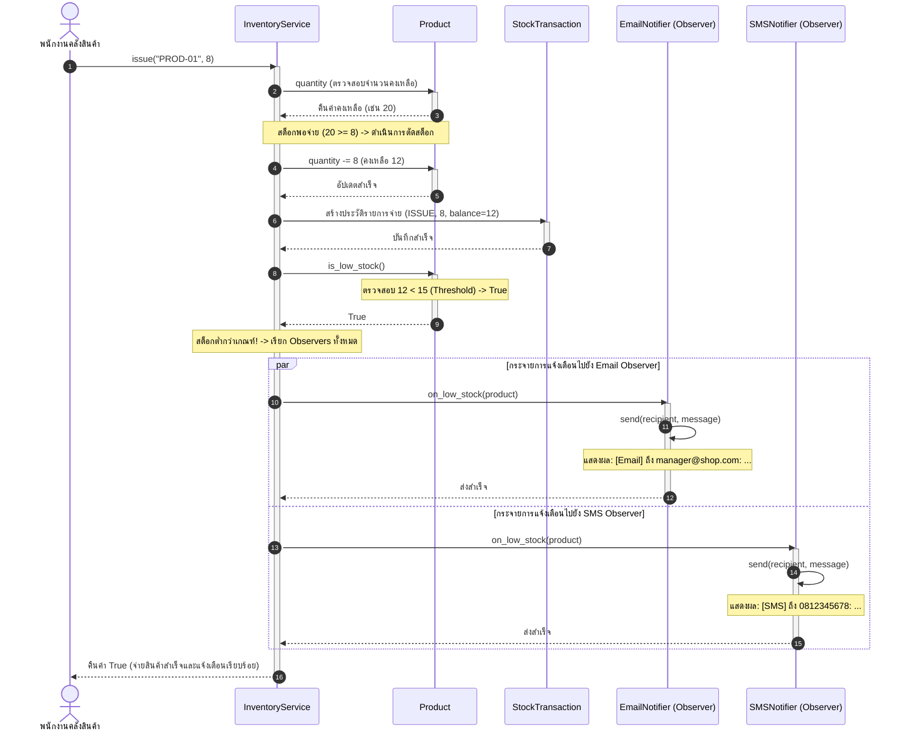

# Sequence Diagram: จ่ายสินค้าจนสต็อกต่ำกว่า Threshold

ไดอะแกรมลำดับการทำงาน (Sequence Diagram) แสดงการทำงานเมื่อพนักงานบันทึกจ่ายสินค้าออกจากคลัง (`InventoryService.issue()`) จนส่งผลให้สต็อกสินค้าคงเหลือต่ำกว่าเกณฑ์ (`< threshold`) และระบบกระจายเหตุการณ์ไปยัง Observers เพื่อส่งข้อความแจ้งเตือน

